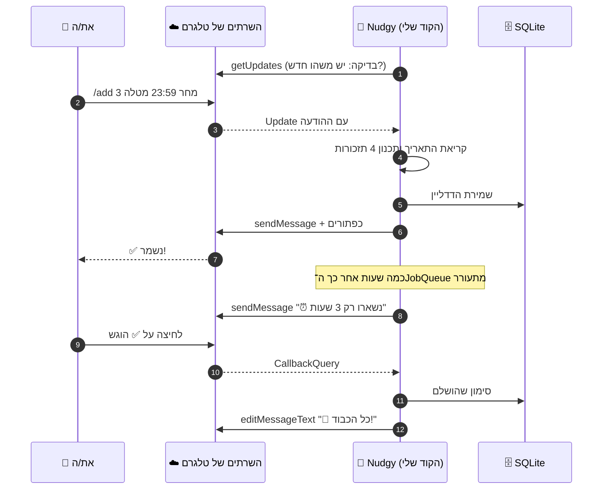
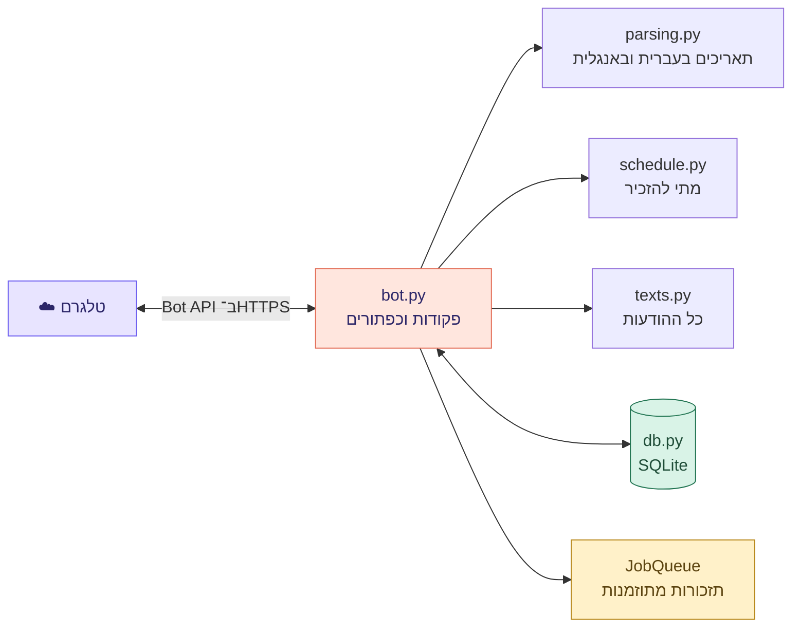

<div dir="rtl">

<p align="center">
  <a href="#run-it-yourself"></a>
</p>

<p align="center"><a href="README.md"></a></p>

<p align="center">
  <a href="#run-it-yourself"></a>
  <a href="#meet-the-telegram-api"></a>
  <a href="nudgy/bot.py"></a>
</p>

<p align="center">
  <a href="https://github.com/NoyaAdivi/nudgy-bot/actions/workflows/tests.yml"></a>
  <a href="LICENSE"></a>
  <a href="https://github.com/NoyaAdivi/nudgy-bot/commits/main"></a>
  <a href="https://github.com/NoyaAdivi/nudgy-bot/search?l=python"></a>
</p>

<h3 align="center">הדדליינים שלך, בזמן. בלי לפספס אף הגשה.</h3>

<p align="center">
  Nudgy הוא בוט טלגרם שזוכר את מועדי ההגשה שלך ומזכיר לך לפני כל אחד מהם.<br>
  כותבים <code>/add מחר 23:59 מטלה 3 באלגוריתמים</code> והוא דואג לכל השאר, בעברית או באנגלית.
</p>

<table align="center" dir="rtl">
  <tr>
    <td align="center" width="25%"><a href="#highlights"><b>🔔 4</b></a><br><sub>תזכורות לכל דדליין</sub></td>
    <td align="center" width="25%"><a href="README.md"><b>🌍 HE · EN</b></a><br><sub>מדבר בשתי השפות</sub></td>
    <td align="center" width="25%"><a href="#meet-the-telegram-api"><b>🔌 ראשון</b></a><br><sub>API חיצוני שבניתי עליו</sub></td>
    <td align="center" width="25%"><a href="tests/test_core.py"><b>🧪 11</b></a><br><sub>בדיקות בכל push</sub></td>
  </tr>
</table>

<a name="highlights"></a>
<p align="center"><a href="#see-it-in-action"></a></p>

<table dir="rtl">
  <tr valign="top">
    <td valign="top" width="33%" dir="rtl">
      <p><b>🗓 מוסיפים דדליין איך שנוח</b></p>
      <ul>
        <li><a href="nudgy/parsing.py"><b>תאריכים פשוטים:</b></a> <code>20/11</code>, <code>מחר</code>, <code>שישי</code>, <code>+3</code>, <code>tomorrow</code></li>
        <li><b>לא כתבתם שעה?</b> הבוט שם 23:59, השעה הקלאסית</li>
        <li><b>שלב אחרי שלב:</b> שולחים רק <code>/add</code> והבוט שואל</li>
        <li><b>תאריך שעבר נחסם</b> עם הודעה נעימה</li>
      </ul>
    </td>
    <td valign="top" width="33%" dir="rtl">
      <p><b>🔔 תזכורות שבאמת עוזרות</b></p>
      <ul>
        <li><a href="nudgy/schedule.py"><b>4 תזכורות:</b></a> 3 ימים, יום ו־3 שעות לפני, ובדיוק בזמן</li>
        <li><b>לחיצה אחת</b> כדי לסמן שהוגש או לדחות בשעה</li>
        <li><b>צבע לפי דחיפות:</b> 🔴 היום, 🟠 בקרוב, 🟡 השבוע, 🟢 בהמשך</li>
        <li><b>/today</b> ו־<b>/week</b> מראים מה מתקרב</li>
      </ul>
    </td>
    <td valign="top" width="33%" dir="rtl">
      <p><b>💜 בנוי כמו מוצר אמיתי</b></p>
      <ul>
        <li><a href="nudgy/db.py"><b>שמירה ב־SQLite</b></a>, כך שהפעלה מחדש לא מוחקת כלום</li>
        <li><a href="nudgy/texts.py"><b>דו־לשוני לגמרי</b></a>, לפי שפת הטלגרם שלך</li>
        <li><b>בטוח מהיסוד:</b> הטוקן ב־<code>.env</code>, טקסט המשתמש מנוטרל, וכל צ'אט רואה רק את שלו</li>
        <li><a href="https://github.com/NoyaAdivi/nudgy-bot/actions/workflows/tests.yml"><b>CI</b></a> מריץ את הבדיקות על Python 3.11 עד 3.13</li>
      </ul>
    </td>
  </tr>
</table>

<a name="see-it-in-action"></a>
<p align="center"><a href="#meet-the-telegram-api"></a></p>

<p align="center">
  <a href="nudgy/texts.py"></a>
</p>

<p align="center">
  <a href="#commands"><b>פקודות</b></a> ·
  <a href="nudgy/parsing.py"><b>קריאת תאריכים</b></a> ·
  <a href="nudgy/schedule.py"><b>זמני תזכורות</b></a> ·
  <a href="nudgy/texts.py"><b>כל ההודעות</b></a> ·
  <a href="tests/test_core.py"><b>בדיקות</b></a>
</p>

<a name="meet-the-telegram-api"></a>
<p align="center"><a href="#commands"></a></p>

זה הפרויקט הראשון שלי שבנוי על API חיצוני. ככה זה עובד מאחורי כל הודעה:

</div>



<div dir="rtl">

<table dir="rtl">
  <tr valign="top">
    <td width="50%" dir="rtl">
      <p><b>🔑 הפעולות ב־API שאני משתמשת בהן</b></p>
      <ul>
        <li><a href="https://core.telegram.org/bots/api#getupdates"><code>getUpdates</code></a> מבקשת מטלגרם הודעות חדשות</li>
        <li><a href="https://core.telegram.org/bots/api#sendmessage"><code>sendMessage</code></a> שולחת טקסט עם עיצוב HTML</li>
        <li><a href="https://core.telegram.org/bots/api#inlinekeyboardmarkup"><code>InlineKeyboardMarkup</code></a> מוסיפה את הכפתורים</li>
        <li><a href="https://core.telegram.org/bots/api#answercallbackquery"><code>answerCallbackQuery</code></a> מאשרת לחיצה על כפתור</li>
        <li><a href="https://core.telegram.org/bots/api#editmessagetext"><code>editMessageText</code></a> מעדכנת הודעה קיימת</li>
        <li><a href="https://core.telegram.org/bots/api#setmycommands"><code>setMyCommands</code></a> ממלאת את התפריט, בשתי השפות</li>
      </ul>
    </td>
    <td width="50%" dir="rtl">
      <p><b>💡 מה למדתי</b></p>
      <ul>
        <li><b>אימות:</b> כל קריאה כוללת טוקן סודי מ־<a href="https://t.me/BotFather">@BotFather</a>, ולכן הוא נשמר ב־<code>.env</code> ואף פעם לא ב־Git</li>
        <li><b>Polling מול Webhooks:</b> polling רץ על כל מחשב, בלי שרת ציבורי</li>
        <li><b>קוד אסינכרוני:</b> בוט אחד עונה להרבה צ'אטים במקביל</li>
        <li><b>אזורי זמן:</b> הדדליינים נשמרים ב־UTC ומוצגים בשעון ישראל</li>
        <li><b>עיצוב שקל לבדוק:</b> לקריאת התאריכים, לתזמון ולשמירה אין קוד של טלגרם, אז בודקים אותם בלי אינטרנט</li>
      </ul>
    </td>
  </tr>
</table>

<a name="commands"></a>
<p align="center"><a href="#tech-stack"></a></p>

| פקודה | מה היא עושה | דוגמה |
|---|---|---|
| `/start` | אומרת שלום ומראה דוגמה ראשונה | `/start` |
| `/add` | מוסיפה דדליין בשורה אחת, או שואלת שלב אחרי שלב | `/add 20/11 18:00 מעבדת רשתות` |
| `/list` | כל הדדליינים הפתוחים, עם כפתורי ✅ ו־🗑 | `/list` |
| `/today` | מה צריך להגיש היום | `/today` |
| `/week` | 7 הימים הקרובים | `/week` |
| `/lang` | מעבר בין עברית ל־English | `/lang` |
| `/cancel` | עצירת ההוספה שלב אחרי שלב | `/cancel` |
| `/help` | כל הפקודות וכל צורות התאריך | `/help` |

<a name="tech-stack"></a>
<p align="center"><a href="#run-it-yourself"></a></p>

<p align="center"><b>הבוט</b><br>
<a href="https://www.python.org"></a>
<a href="https://docs.python-telegram-bot.org"></a>
<a href="https://core.telegram.org/bots/api"></a>
</p>

<p align="center"><b>מידע וזמנים</b><br>
<a href="https://www.sqlite.org"></a>
<a href="https://apscheduler.readthedocs.io"></a>
<a href="https://docs.python.org/3/library/zoneinfo.html"></a>
</p>

<p align="center"><b>איכות</b><br>
<a href="https://docs.pytest.org"></a>
<a href="https://github.com/NoyaAdivi/nudgy-bot/actions"></a>
</p>

<details>
<summary><b>🏗️ הארכיטקטורה במבט אחד</b></summary>
<br>

</div>



<div dir="rtl">

רק `bot.py` מכיר את טלגרם. כל השאר הוא Python רגיל, ולכן הבדיקות רצות בפחות משנייה ובלי אינטרנט.
</details>

<details>
<summary><b>📂 מבנה הפרויקט</b></summary>

</div>

```
├── nudgy/
│   ├── bot.py        הפקודות, הכפתורים וה־JobQueue של טלגרם
│   ├── parsing.py    "מחר 23:59 מטלה 3" הופך לתאריך אמיתי
│   ├── schedule.py   4 זמני התזכורות
│   ├── db.py         שמירה ב־SQLite
│   └── texts.py      כל ההודעות בעברית ובאנגלית
├── tests/            בדיקות pytest (בלי אינטרנט)
├── tools/            קיצורי דרך ל־Windows (הפעלה, בדיקות)
├── docs/readme/      העיצוב המונפש של הקובץ הזה
└── .github/workflows/tests.yml
```

<div dir="rtl">
</details>

<a name="run-it-yourself"></a>
<p align="center"><a href="#contact"></a></p>

1. בטלגרם פותחים את [@BotFather](https://t.me/BotFather), שולחים `/newbot`, בוחרים שם ומעתיקים את הטוקן.
2. מעתיקים את `.env.example` לקובץ בשם `.env` ומדביקים בו את הטוקן.
3. מפעילים:
   - **ב־Windows:** לחיצה כפולה על [`tools/START-NUDGY.bat`](tools/START-NUDGY.bat). בפעם הראשונה הוא מתקין הכל לבד.
   - **בכל מערכת:**

</div>

```bash
python -m venv .venv
source .venv/bin/activate        # Windows: .venv\Scripts\activate
pip install -r requirements-dev.txt
python -m nudgy
```

<div dir="rtl">

4. פותחים את הבוט בטלגרם ושולחים `/start`.
5. מריצים את הבדיקות עם `pytest` או עם [`tools/TEST-NUDGY.bat`](tools/TEST-NUDGY.bat).

> [!IMPORTANT]
> הטוקן הוא המפתח לבוט. שומרים אותו ב־`.env` (שכבר נמצא ב־[`.gitignore`](.gitignore)) ואף פעם לא מעלים אותו ל־GitHub. אם הוא דלף, שולחים `/revoke` ל־[@BotFather](https://t.me/BotFather) ומקבלים טוקן חדש.

<a name="contact"></a>
<p align="center"><a href="https://www.linkedin.com/in/noya-adivi/"></a></p>

<p align="center">
  <a href="https://www.linkedin.com/in/noya-adivi/"></a>
  <a href="https://noyaadivi.github.io/noya-website"></a>
  <a href="https://github.com/NoyaAdivi/Okeat"></a>
  <a href="https://github.com/NoyaAdivi"></a>
</p>

</div>
