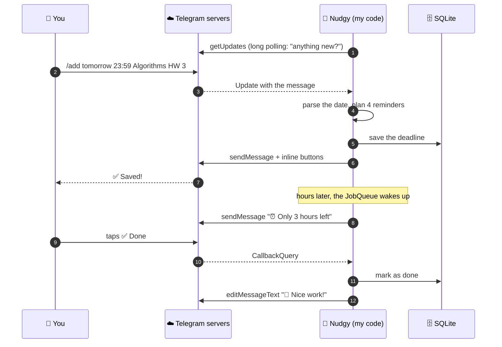
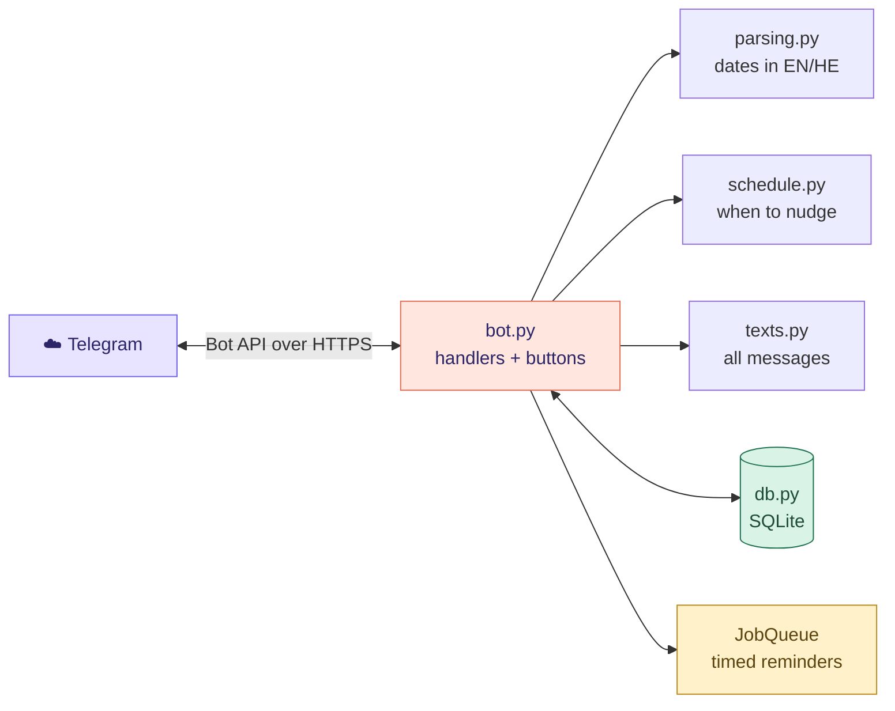

<p align="center">
  <a href="#run-it-yourself"></a>
</p>

<p align="center"><a href="README.he.md"></a></p>

<p align="center">
  <a href="#run-it-yourself"></a>
  <a href="#meet-the-telegram-api"></a>
  <a href="nudgy/bot.py"></a>
</p>

<p align="center">
  <a href="https://github.com/NoyaAdivi/nudgy-bot/actions/workflows/tests.yml"></a>
  <a href="LICENSE"></a>
  <a href="https://github.com/NoyaAdivi/nudgy-bot/commits/main"></a>
  <a href="https://github.com/NoyaAdivi/nudgy-bot/search?l=python"></a>
</p>

<h3 align="center">Your deadlines, right on time. Never miss a submission again.</h3>

<p align="center">
  Nudgy is a Telegram bot that remembers your assignment deadlines and nudges you before each one.<br>
  Write <code>/add tomorrow 23:59 Algorithms HW 3</code> and it takes care of the rest, in English or Hebrew.
</p>

<table align="center">
  <tr>
    <td align="center" width="25%"><a href="#highlights"><b>🔔 4</b></a><br><sub>nudges per deadline</sub></td>
    <td align="center" width="25%"><a href="README.he.md"><b>🌍 HE · EN</b></a><br><sub>talks in both languages</sub></td>
    <td align="center" width="25%"><a href="#meet-the-telegram-api"><b>🔌 1st</b></a><br><sub>external API I built on</sub></td>
    <td align="center" width="25%"><a href="tests/test_core.py"><b>🧪 11</b></a><br><sub>tests on every push</sub></td>
  </tr>
</table>

<a name="highlights"></a>
<p align="center"><a href="#see-it-in-action"></a></p>

<table>
  <tr valign="top">
    <td valign="top" width="33%">
      <p><b>🗓 Add a deadline your way</b></p>
      <ul>
        <li><a href="nudgy/parsing.py"><b>Plain dates:</b></a> <code>20/11</code>, <code>tomorrow</code>, <code>friday</code>, <code>+3</code>, <code>מחר</code></li>
        <li><b>No time given?</b> It sets 23:59, the classic deadline</li>
        <li><b>Step by step:</b> just send <code>/add</code> and the bot asks</li>
        <li><b>Past dates are blocked</b> with a friendly message</li>
      </ul>
    </td>
    <td valign="top" width="33%">
      <p><b>🔔 Reminders that actually help</b></p>
      <ul>
        <li><a href="nudgy/schedule.py"><b>4 nudges:</b></a> 3 days, 1 day and 3 hours before, and on time</li>
        <li><b>One tap</b> to mark it done or snooze for an hour</li>
        <li><b>Colored urgency:</b> 🔴 today, 🟠 soon, 🟡 this week, 🟢 later</li>
        <li><b>/today</b> and <b>/week</b> show what's coming</li>
      </ul>
    </td>
    <td valign="top" width="33%">
      <p><b>💜 Built like a real product</b></p>
      <ul>
        <li><a href="nudgy/db.py"><b>SQLite storage</b></a>, so a restart loses nothing</li>
        <li><a href="nudgy/texts.py"><b>Fully bilingual</b></a>, picked from your Telegram language</li>
        <li><b>Safe by design:</b> token in <code>.env</code>, user text escaped, tasks private per chat</li>
        <li><a href="https://github.com/NoyaAdivi/nudgy-bot/actions/workflows/tests.yml"><b>CI</b></a> runs the tests on Python 3.11 to 3.13</li>
      </ul>
    </td>
  </tr>
</table>

<a name="see-it-in-action"></a>
<p align="center"><a href="#meet-the-telegram-api"></a></p>

<p align="center">
  <a href="nudgy/texts.py"></a>
</p>

<p align="center">
  <a href="#commands"><b>Commands</b></a> ·
  <a href="nudgy/parsing.py"><b>Date parsing</b></a> ·
  <a href="nudgy/schedule.py"><b>Reminder times</b></a> ·
  <a href="nudgy/texts.py"><b>All messages</b></a> ·
  <a href="tests/test_core.py"><b>Tests</b></a>
</p>

<a name="meet-the-telegram-api"></a>
<p align="center"><a href="#commands"></a></p>

This was my first project built on an external API. Here is what happens behind every message:



<table>
  <tr valign="top">
    <td width="50%">
      <p><b>🔑 The API methods I use</b></p>
      <ul>
        <li><a href="https://core.telegram.org/bots/api#getupdates"><code>getUpdates</code></a> asks Telegram for new messages</li>
        <li><a href="https://core.telegram.org/bots/api#sendmessage"><code>sendMessage</code></a> sends text with HTML formatting</li>
        <li><a href="https://core.telegram.org/bots/api#inlinekeyboardmarkup"><code>InlineKeyboardMarkup</code></a> adds the buttons</li>
        <li><a href="https://core.telegram.org/bots/api#answercallbackquery"><code>answerCallbackQuery</code></a> confirms a button tap</li>
        <li><a href="https://core.telegram.org/bots/api#editmessagetext"><code>editMessageText</code></a> updates a message in place</li>
        <li><a href="https://core.telegram.org/bots/api#setmycommands"><code>setMyCommands</code></a> fills the menu, in both languages</li>
      </ul>
    </td>
    <td width="50%">
      <p><b>💡 What I learned</b></p>
      <ul>
        <li><b>Authentication:</b> every call carries a secret token from <a href="https://t.me/BotFather">@BotFather</a>, so it lives in <code>.env</code> and never in Git</li>
        <li><b>Polling vs webhooks:</b> polling runs on any laptop with no public server</li>
        <li><b>Async code:</b> one bot answers many chats at the same time</li>
        <li><b>Time zones:</b> deadlines are stored in UTC and shown in Israel time</li>
        <li><b>Testable design:</b> parsing, scheduling and storage have no Telegram code, so they are tested without the network</li>
      </ul>
    </td>
  </tr>
</table>

<a name="commands"></a>
<p align="center"><a href="#tech-stack"></a></p>

| Command | What it does | Example |
|---|---|---|
| `/start` | Says hi and shows a first example | `/start` |
| `/add` | Adds a deadline in one line, or asks step by step | `/add 20/11 18:00 Networks lab` |
| `/list` | All open deadlines, with ✅ and 🗑 buttons | `/list` |
| `/today` | What's due today | `/today` |
| `/week` | The next 7 days | `/week` |
| `/lang` | Switch between עברית and English | `/lang` |
| `/cancel` | Stop the step-by-step add | `/cancel` |
| `/help` | Every command and date format | `/help` |

<a name="tech-stack"></a>
<p align="center"><a href="#run-it-yourself"></a></p>

<p align="center"><b>Bot</b><br>
<a href="https://www.python.org"></a>
<a href="https://docs.python-telegram-bot.org"></a>
<a href="https://core.telegram.org/bots/api"></a>
</p>

<p align="center"><b>Data &amp; time</b><br>
<a href="https://www.sqlite.org"></a>
<a href="https://apscheduler.readthedocs.io"></a>
<a href="https://docs.python.org/3/library/zoneinfo.html"></a>
</p>

<p align="center"><b>Quality</b><br>
<a href="https://docs.pytest.org"></a>
<a href="https://github.com/NoyaAdivi/nudgy-bot/actions"></a>
</p>

<details>
<summary><b>🏗️ Architecture at a glance</b></summary>
<br>



Only `bot.py` knows about Telegram. Everything else is plain Python, which is why the tests run in under a second with no internet.
</details>

<details>
<summary><b>📂 Project structure</b></summary>

```
├── nudgy/
│   ├── bot.py        Telegram handlers, buttons and the JobQueue
│   ├── parsing.py    "tomorrow 23:59 HW 3" becomes a real date
│   ├── schedule.py   the 4 reminder times
│   ├── db.py         SQLite storage
│   └── texts.py      every message in English and Hebrew
├── tests/            pytest tests (no network needed)
├── tools/            one-click Windows helpers (start, test)
├── docs/readme/      the animated art in this README
└── .github/workflows/tests.yml
```
</details>

<a name="run-it-yourself"></a>
<p align="center"><a href="#contact"></a></p>

1. In Telegram, open [@BotFather](https://t.me/BotFather), send `/newbot`, pick a name and copy the token.
2. Copy `.env.example` to `.env` and paste the token.
3. Start it:
   - **Windows:** double-click [`tools/START-NUDGY.bat`](tools/START-NUDGY.bat). The first run installs everything.
   - **Any system:**
     ```bash
     python -m venv .venv
     source .venv/bin/activate        # Windows: .venv\Scripts\activate
     pip install -r requirements-dev.txt
     python -m nudgy
     ```
4. Open your bot in Telegram and send `/start`.
5. Run the tests with `pytest` or [`tools/TEST-NUDGY.bat`](tools/TEST-NUDGY.bat).

> [!IMPORTANT]
> The token is the key to your bot. Keep it in `.env` (already in [`.gitignore`](.gitignore)) and never commit it. If it leaks, send `/revoke` to [@BotFather](https://t.me/BotFather) for a new one.

<a name="contact"></a>
<p align="center"><a href="https://www.linkedin.com/in/noya-adivi/"></a></p>

<p align="center">
  <a href="https://www.linkedin.com/in/noya-adivi/"></a>
  <a href="https://noyaadivi.github.io/noya-website"></a>
  <a href="https://github.com/NoyaAdivi/Okeat"></a>
  <a href="https://github.com/NoyaAdivi"></a>
</p>
